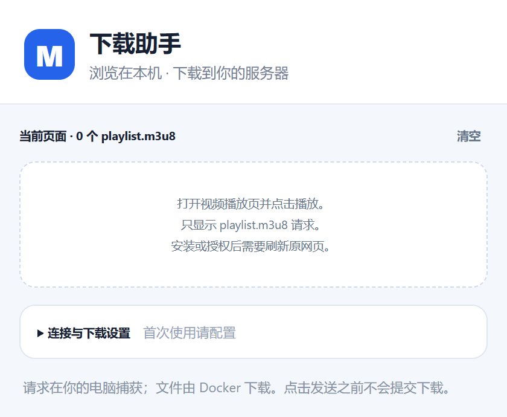

# M3U8 下载助手 · 独立 Chrome 扩展

面向 [lzwme/m3u8-dl](https://github.com/lzwme/m3u8-dl) WebUI 的独立 Chrome 扩展。在本机浏览器中捕获 `playlist.m3u8` 请求，确认后打开已部署的下载网站，自动填入地址、名称、保存目录与固定的两行请求头。

版本：1.0.0。更新已有插件时，用新文件覆盖原插件文件夹，在 `chrome://extensions` 中点击该插件的重新加载按钮，再刷新视频网页。

## 配套项目

[m3u8-dl](https://github.com/lzwme/m3u8-dl) 是基于 Node.js 的开源 HLS 视频下载与管理工具，提供 WebUI、命令行和 Node.js API，支持 Docker 部署、多线程分片下载、缓存续传、批量任务管理，以及通过 FFmpeg 合并视频文件。

本插件配合其 WebUI 使用：浏览器端负责捕获视频地址、识别名称和生成下载参数，m3u8-dl 服务端负责执行下载、保存文件和管理任务。请先按照上游项目文档部署 m3u8-dl，并将可访问的 WebUI 地址填入插件设置。接入插件无需修改、重建或重新部署已有下载服务。

## 界面预览

插件弹窗集中展示捕获的 `playlist.m3u8` 请求，并提供下载网站连接和保存目录设置。



## 安装

1. 从 [GitHub Releases](https://github.com/remixjc/m3u8-dl-browser-widget/releases/latest) 下载插件安装 ZIP 并解压。不要选择 GitHub 自动附带的 Source code 源码归档。使用 Google Chrome 127 或更新版本，打开 `chrome://extensions`。
2. 打开右上角「开发者模式」。
3. 点击「加载已解压的扩展程序」，选择包含 `manifest.json` 的 `m3u8-download-helper` 文件夹。若拿到 ZIP，先解压。
4. 在浏览器工具栏的扩展菜单中固定「M3U8 下载助手」。
5. 点击插件，展开「连接与下载设置」，填写下载网站地址，例如 `http://192.168.1.10:6600`。这个地址必须能从你当前电脑访问。
6. 下载根目录填写 **Docker 容器内** 的路径，默认为 `/app/downloads`，不是电脑上的下载文件夹。
7. 点击「保存设置并授权下载网站」。Chrome 会询问是否允许插件访问该下载网站，允许后才能自动补填目录。

不要把插件目录放在会自动清理的临时目录中；加载后应保留该文件夹。可以先复制到自己的长期存放位置再安装。

## 使用

1. 在本机 Chrome 打开视频播放页。首次安装或增加授权后，刷新旧标签页。
2. 点击播放，等待播放器真正请求 `playlist.m3u8`。
3. 网页右下角会出现「发现视频」提示，也可以直接点击工具栏的插件图标。
4. 插件展示当前页面的 `playlist.m3u8` 候选资源、识别的编号和保存目录。视频名可以在确认前修改。
5. 点击「确认发送」，打开已部署网站的新建下载表单，自动补填路径与请求头。
6. 默认保留网站的「开始下载」按钮供核对。想要只确认一次，可在插件中开启「插件确认后自动点击网站的开始下载」。

示例：播放页路径含 `sw-359-...` 时，名称为 `SW-359`，任务目录为 `/app/downloads/SW-359`，通常输出为 `SW-359.mp4`。实际扩展名和重名处理由现有下载器决定。

遇到网站访问密码时，在打开的下载页中正常登录。插件最长等待十分钟；输入密码后继续自动填入。插件不保存下载网站密码，也不把密码传入链接。

## 捕获与命名

- 默认有权捕获 `missav.live` 及其子域名、`surrit.com` 及其子域名的请求。
- 若网站跳转到其他域名，或播放器使用其他 CDN，在插件设置中点击「为其他网站开启捕获权限」，再刷新播放页。该操作会申请所有 HTTP/HTTPS 网站访问权限。
- 只观察请求，不拦截、不修改视频网站请求。严格匹配 URL 路径最后的文件名 `playlist.m3u8`，允许后接查询参数；`master.m3u8`、`index.m3u8`、无后缀接口或仅在查询参数中出现该名称的请求都不会被捕获。HLS Content-Type 也不能绕过文件名过滤。
- 不采集普通 `.ts` 分片，不把 `blob:` 地址当作 m3u8。
- 优先从顶层播放页路径中提取 `SW-359` 这样的编号，其次看页面标题，最后使用清理后的标题或路径。不会从 CDN UUID 生成名称。
- 完整保留 URL 查询参数，包括签名和 token；仅对完整 URL 与来源页面完全相同的请求去重。
- 每个标签页最多保留 50 个候选。捕获内容保存在浏览器会话内存，关闭标签、重新加载插件或重启浏览器后清除；设置保存在本机，不使用云同步。
- 同一页面可能请求多个不同目录下的 `playlist.m3u8`，全部展示供选择；其他名称的主清单或清晰度子清单不会显示。实际清晰度处理由现有下载器决定。
- 未提供直播持续录制、DRM 解密或验证码绕过功能。

## Referer 与其他请求头

请求头固定为以下两行，字段大小写和 User-Agent 文本保持一致：

```text
Referer: 捕获时浏览器地址栏中的完整网址
User-Agent: Mozilla/5.0 (Windows NT 10.0; Win64; x64) AppleWebKit/537.36
```

Referer 使用顶层播放页地址，包含原有路径、查询参数和 fragment，不使用播放器 iframe 或 CDN 地址。两行之间是实际换行，不额外追加反斜杠。

插件不再读取真实请求头，也不携带 Origin、Cookie 或 Authorization；旧版的 Referer 规则和敏感头设置不再生效。

请求头通过 URL 的 hash 传给下载网站，不放到 query 中；表单填好后插件清除 hash。hash 不会随 HTTP 请求发给服务器，但在清除前同页 JavaScript 能读取它，因此只配置你信任的下载网站。视频 URL 仍按现有 WebUI 的协议进入 query，可能出现在服务器访问日志中。

## 网络与项目兼容性

视频网页由本机浏览器访问，Docker 不需要访问视频列表或播放页。**实际下载仍由 Docker 执行**，因此 Docker 必须能访问清单、分片和必要的密钥地址；如果这些地址也不可达，仍需要为下载器配置可用网络出口。

插件按当前仓库版本的 WebUI 适配：

- 使用现有 `/page/download?action=new` 入口预填 URL、名称和请求头。
- 兼容该入口对下载 URL 的二次解码，避免破坏 `%2F`、`%25` 等签名参数。
- 当前 WebUI 不读取 `saveDir` 路由参数，所以插件在下载页中通过 DOM 输入事件补填目录。
- 目录桥接器适配当前中英文「开始下载」按钮及表单结构，等 `/api/config` 鉴权成功后才操作。
- 表单结构不匹配时提示手动核对，不猜测其他按钮，也不提交。
- 自动开始只点击现有表单按钮；提交成功与否以下载网站的任务列表为准，不把「已打开页面」等同于「下载成功」。
- 首版不通过额外接口直接创建下载任务，不要求原项目增加接口。若部署版本 UI 与当前仓库不同，自动填目录可能需要调整适配器。

## 目录

```text
manifest.json         Chrome Manifest V3 配置
background.js         请求捕获、会话存储、确认与下载页交接
core.js               命名、路径、请求头与跳转链接生成
popup.*               工具栏确认弹窗与设置
page-prompt.js        视频页面右下角提示
download-bridge.js    原下载网站表单适配器
docs/images/          README 界面截图
tests/                无第三方依赖的自动检查
scripts/              版本同步与跨平台 ZIP 打包
.github/workflows/    标签触发的自动发布流程
```

## 打包与发布

开发和打包需要 Node.js 22 或更新版本。没有第三方运行依赖，无需安装依赖即可执行：

```powershell
pnpm test
pnpm package
```

不使用 pnpm 时，等效打包命令为 `node scripts/package.mjs`。脚本从白名单收集插件运行文件、README 和界面截图，统一文本换行、文件顺序和 ZIP 时间戳，输出：

```text
dist/
├── m3u8-download-helper-v1.0.0.zip
└── m3u8-download-helper-v1.0.0.zip.sha256
```

ZIP 内含 `m3u8-download-helper/` 文件夹，可直接解压后加载，不包含 `.git`、测试浏览器数据、开发脚本或本机设置。打包脚本同时校验 `package.json` 与 `manifest.json` 的版本一致。

发布新版本：

1. 执行 `pnpm version:set 1.0.1`，同步 package、manifest 和 README 版本。
2. 新建 `docs/releases/v1.0.1.md`，编写该版本的功能、修复和安装说明。
3. 执行 `pnpm test` 和 `pnpm package`，检查生成的安装包。
4. 提交修改并推送 `main`，再创建和推送同名版本标签：

```powershell
git tag -a v1.0.1 -m "Release v1.0.1"
git push origin v1.0.1
```

GitHub Actions 会在标签对应的提交上运行逻辑、打包和 Chrome 模拟表单检查，校验标签版本与发布说明，然后创建正式 GitHub Release 并上传 ZIP 与 SHA-256 文件。流程使用仓库提供的 `GITHUB_TOKEN`，无需额外配置个人 Token；仓库需允许 GitHub Actions 运行。已发布的同名 Release 不会被自动覆盖。

也可在 Actions 的 Release 工作流中手动运行，填写已存在的版本标签，用于失败后重试。这里发布的是 GitHub 下载包；Chrome 的安装方式仍为加载已解压的扩展程序。

## 验证

无需安装依赖：

```powershell
node --test tests/*.test.js
node tests/browser-check.mjs
```

第二条命令使用本机 Chrome 的无界面模式和独立测试配置，只访问本机模拟页面，不访问实际视频网站、不提交真实下载。默认 Chrome 路径为 `C:\Program Files\Google\Chrome\Application\chrome.exe`，可通过 `CHROME_PATH` 指定。测试配置和截图输出到 `.test-output`，不包含在交付 ZIP 中。

完成了逻辑测试与模拟页面浏览器验证；尚未在实际视频网站或用户已部署的 Docker 实例上完成端到端联调。
